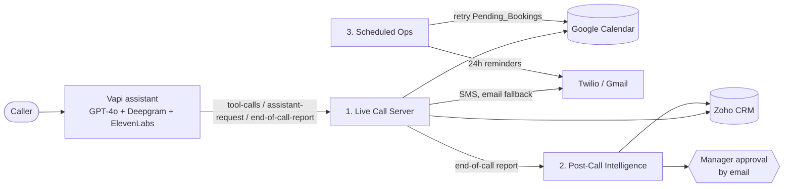

# Voice AI Receptionist (n8n + Vapi)

An AI phone receptionist that answers calls, books / reschedules / cancels appointments in Google Calendar, recognises returning callers from Zoho CRM, and turns every call into a scored CRM lead. Built as three n8n workflows plus a Vapi assistant config.

The design goal is that a caller always gets a sensible answer, even when a dependency is down. Calendar outages fall back to a retry queue, SMS falls back to email, and AI analysis falls back to keyword rules.

## Architecture



## Workflows

| File | Role | Nodes |
|---|---|---|
| `vapi-assistant-config.json` | Vapi assistant: system prompt, 6 tools, voice, transcriber, server URL | n/a |
| `voice-receptionist-1-live-call-server.json` | Single webhook that Vapi calls during the call | 59 |
| `voice-receptionist-2-post-call-intelligence.json` | AI analysis, call log, Zoho lead upsert, human review | 27 |
| `voice-receptionist-3-scheduled-ops.json` | Retry queue for failed bookings and appointment reminders | 23 |

### 1. Live Call Server
One webhook (`POST /webhook/vapi-receptionist`) is the Vapi **Server URL**. It routes three message types:

- **`tool-calls`**: `check_availability`, `book_appointment`, `find_appointments`, `reschedule_appointment`, `cancel_appointment`, `request_callback`.
- **`assistant-request`**: caller recognition. Looks the phone number up in Zoho Leads (7.5 s budget) so the assistant can greet returning callers by name.
- **`end-of-call-report`**: acknowledged immediately, then forwarded to workflow 2.

Behaviour worth knowing:
- Availability comes from a 7-day Google Calendar free/busy query, computed against opening hours, slot step, buffer, minimum notice and per-service duration.
- The slot is re-checked just before writing, so two callers cannot take the same time.
- Event IDs are deterministic, so re-booking the same slot is idempotent.
- Reschedule and cancel require the caller's phone number to match the event.
- Every Calendar call retries 3 times. If the calendar is still unreachable, the booking is saved to the `Pending_Bookings` sheet ("request mode"), the caller is told the team will confirm by text, and a throttled alert email goes out.
- Confirmations go out by Twilio SMS, with an email fallback.

### 2. Post-Call Intelligence
Triggered by `POST /webhook/vapi-post-call` from workflow 1.

1. Skips calls that were not meaningful.
2. OpenAI analyses the transcript: intent, outcome, sentiment, urgency, lead score and a follow-up draft. A keyword-rule analysis is the fallback.
3. Writes a row to `Call_Log`.
4. Upserts the lead in Zoho (4 retries) and adds a call note. If Zoho keeps failing, the record is queued in `CRM_Queue` and an alert is sent.
5. **Human-in-the-loop:** complaints, negative sentiment, high urgency or `needsHuman` send a manager an Approve / Decline email. Approve sends the AI follow-up to the caller (SMS, email fallback). Decline creates a Zoho task for staff.

Selective alerting: only high-urgency or emergency calls and CRM failures email you.

### 3. Scheduled Ops
- **Every 10 minutes:** retries `Pending_Bookings`. Success creates the event, sends an SMS and marks the row confirmed. After 3 failures a staff member gets an approval email (approve = staff will call the customer, decline = close the request) and the customer is notified.
- **Every hour:** sends reminders about 24 hours before voice-booked appointments (SMS, email fallback) and marks the event as reminded so it never double-sends.

## Vapi assistant
`vapi-assistant-config.json` defines the assistant (GPT-4o at temperature 0.3, ElevenLabs voice, Deepgram `nova-2` transcriber, 15-minute max call, 30 s silence timeout). The prompt enforces:

- short spoken sentences, one question at a time;
- always call `check_availability` before offering times, at most 3 options;
- read details back and get an explicit yes before booking, cancelling or rescheduling;
- one tool call at a time;
- emergencies: tell the caller to contact emergency services, then raise a high-urgency callback;
- no medical, legal or pricing advice.

## Setup

**Prerequisites:** n8n (public HTTPS URL), Vapi account, Google Calendar, Google Sheets, Gmail, Twilio, Zoho CRM, OpenAI key.

1. **Google Sheet** with tabs and headers:
   - `Pending_Bookings`: `requestId, createdAt, status, attempts, name, phone, email, service, start, end, notes, callId, lastError`
   - `Call_Log`, `CRM_Queue`, `Bookings`, `Callbacks`, `Raw_Reports`
2. **Import** workflows 2, 3, then 1. Attach credentials: Google Calendar, Sheets, Gmail, Zoho OAuth2, OpenAI, Twilio (HTTP Basic: Account SID / Auth Token) and a Header Auth credential named `Vapi / Pipeline Shared Secret`.
3. **Replace placeholders:** `REPLACE_ACCOUNT_SID` and the Twilio from-number in the Twilio nodes, `YOUR-N8N-DOMAIN` in `Forward To Post-Call`, your Sheet ID, and the alert / approver email addresses.
4. **Business config:** edit the `Load Config` code node in workflow 1.
   ```js
   businessName: 'Acme Dental',
   timezone: 'America/New_York',
   calendarId: 'primary',
   openDays: [1, 2, 3, 4, 5],        // 1 = Mon ... 7 = Sun
   openTime: '09:00', closeTime: '17:00',
   slotStepMin: 30, bufferMin: 10, minNoticeMin: 60, maxDaysAhead: 60,
   services: { consultation: 30, checkup: 45, cleaning: 60, emergency: 30 },
   assistantId: 'REPLACE_VAPI_ASSISTANT_ID'
   ```
   Workflow 3 has its own calendar ID / timezone constants in its Code nodes.
5. **Vapi:** create the assistant with `POST https://api.vapi.ai/assistant` (or paste the JSON into the dashboard). Set the Server URL to `https://YOUR-N8N-DOMAIN/webhook/vapi-receptionist` and make its Bearer credential match the n8n header-auth secret. Add a `transferCall` tool in the dashboard if you want human handoff in business hours. Field names should be checked against the current Vapi docs.
6. **Error workflow:** set a global error handler in each workflow's Settings.
7. Zoho data centre: change `zohoapis.com` to `.eu`, `.in` or `.com.au` if needed.
8. Activate all three workflows and place a test call.

## Customising
- New client: change `Load Config` and the Vapi `firstMessage` / prompt. No other node edits are needed.
- New services: add them to `services` (name: minutes) and to the `check_availability` tool description.

## Tech
n8n, Vapi, OpenAI (GPT-4o on the call, OpenAI for post-call analysis), Deepgram, ElevenLabs, Google Calendar / Sheets, Gmail, Twilio, Zoho CRM.
